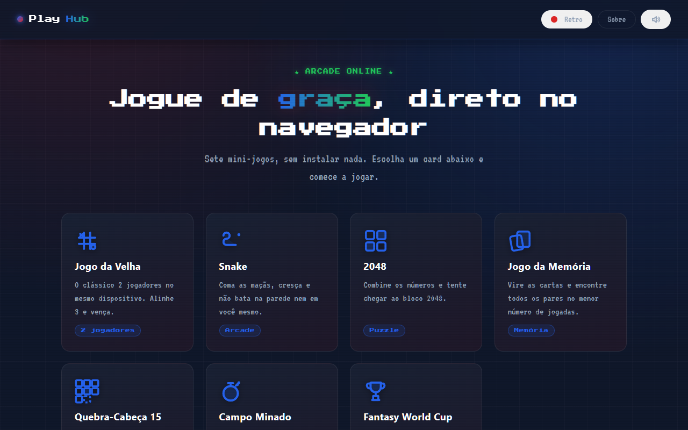
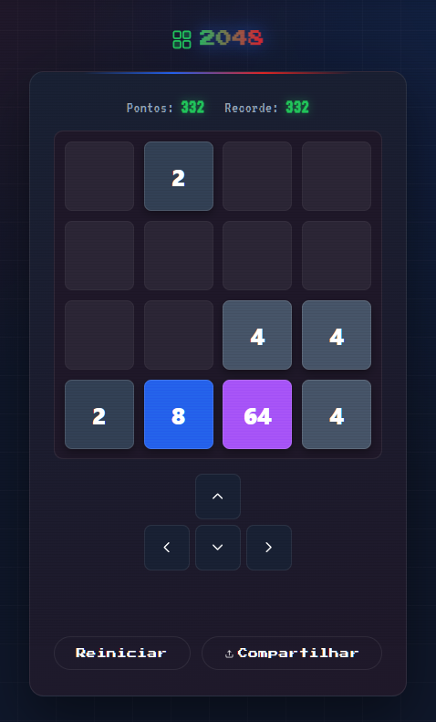
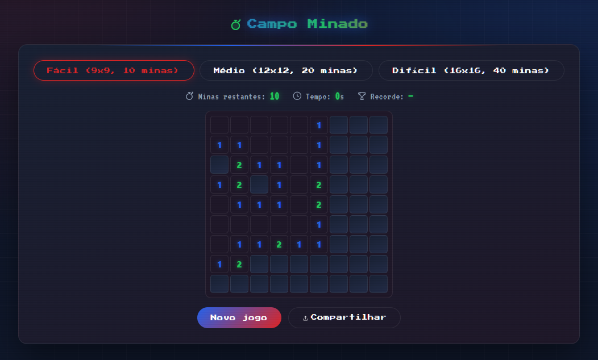
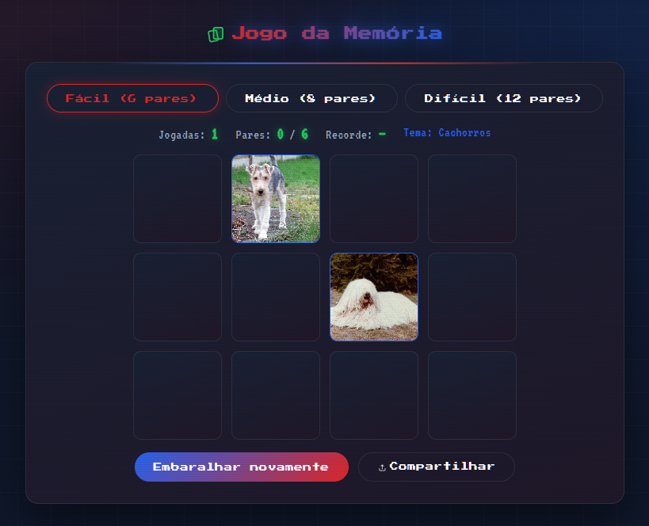
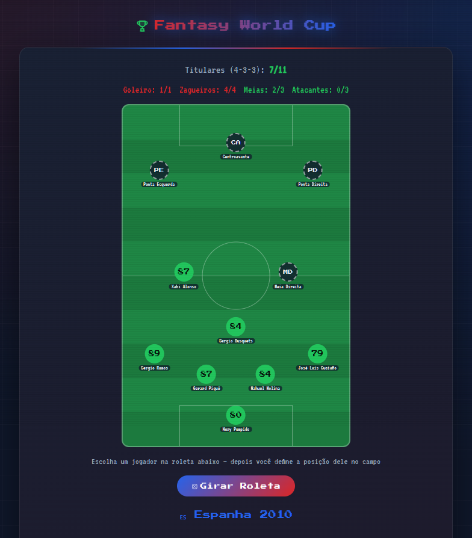
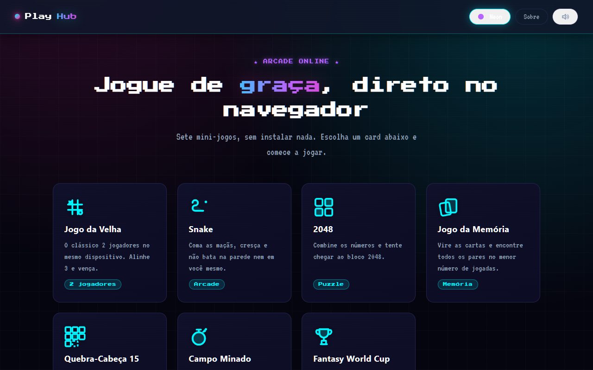
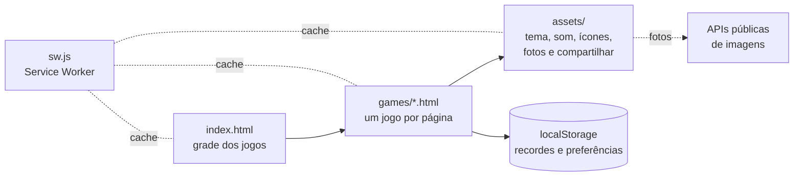

<p align="center">
  <picture>
    <source media="(max-width: 767px)" srcset="https://raw.githubusercontent.com/IsaacGomes260653/CEUB_CIENCIA_2026/main/.github/banner-mobile.svg">
    
  </picture>
</p>

<p align="center">
  <b>Sete mini-jogos que abrem direto no navegador, sem instalar nada, e continuam funcionando sem internet.</b><br>
  <a href="https://isaacgomes260653.github.io/CEUB_CIENCIA_2026/"><b>Jogar agora</b></a>
</p>

<p align="center">
  
  
  
  
  <a href="LICENSE"></a>
  
</p>

## Capturas



<table>
  <tr>
    <td width="50%" valign="top"></td>
    <td width="50%" valign="top"><br><br></td>
  </tr>
</table>



<details>
<summary>Tema Neon</summary>



</details>

As capturas foram feitas com o Playwright, com o projeto rodando localmente.

## Funcionalidades

| Jogo | Como funciona |
|---|---|
| Jogo da Velha | Dois jogadores no mesmo aparelho, com o placar de vitórias e empates guardado. |
| Snake | Setas, WASD ou botões na tela. Coma as maçãs, cresça e não bata na parede nem em você mesmo. |
| 2048 | Setas, botões ou arrastar no celular. Combine as peças até chegar ao 2048. |
| Jogo da Memória | Três níveis (6, 8 ou 12 pares) e cartas com fotos reais de cachorros, gatos, raposas, pássaros, shibas ou Pokémon. Sem internet, usa ícones. |
| Quebra-Cabeça 15 | Ordene as peças de 1 a 15 ou monte uma foto. |
| Campo Minado | Três níveis. Clique direito ou toque longo marca a bandeira. |
| Fantasy World Cup | Escolha formação (4-4-2, 4-3-3, 3-5-2, 5-3-2 ou 4-2-3-1) e estilo, escale jogadores de 22 elencos históricos de Copas sorteados numa roleta e dispute fase de grupos, semifinal e final, com pênaltis no empate. |

Em todo o site:

- **Funciona offline e pode ser instalado** como app (PWA).
- **Recordes salvos no aparelho**: cada jogo guarda o seu melhor resultado no navegador, sem conta e sem servidor.
- **Dois temas**, Retro e Neon, e efeitos sonoros que podem ser desligados. As duas escolhas ficam salvas.
- **Compartilhar o resultado** pelo menu do celular ou, no computador, copiando o texto.

## Tecnologias

| Tecnologia | Por quê |
|---|---|
| HTML, CSS e JavaScript puros | Sem build e sem dependências: cada jogo é uma página que abre sozinha, e o GitHub Pages publica direto da branch. |
| Canvas | O Snake redesenha o tabuleiro a cada passo, o que fica mais simples e leve num canvas do que em elementos HTML. |
| Variáveis CSS | Os temas Retro e Neon trocam só as variáveis de cor, sem duplicar o estilo. |
| Service Worker e Web App Manifest | Deixam o site instalável e jogável sem internet. O cache responde na hora e se atualiza em segundo plano. |
| Web Audio API | Os efeitos sonoros são gerados por osciladores, então o site não carrega nenhum arquivo de áudio. |
| localStorage | Guarda recordes, placar, tema e som no próprio navegador. |
| Web Share API | Abre o menu de compartilhar do celular. No computador, cai para a área de transferência. |
| APIs públicas de imagens | Dog CEO, The Cat API, RandomFox, shibe.online e os sprites da PokeAPI dão as fotos da Memória e do Quebra-Cabeça, sem chave de acesso. Cada pedido tem limite de 5 segundos e, se falhar, o jogo usa ícones ou números. |
| Press Start 2P e VT323 | Fontes do Google Fonts que dão o visual de fliperama. |

## Como funciona



- Cada jogo é um arquivo HTML com o próprio script. O que é comum a todos (tema, som, ícones, fotos e compartilhar) fica em `assets/` e é carregado por cada página.
- Na primeira visita, o `sw.js` guarda no cache todas as páginas e os arquivos de `assets/`. Depois disso, o site abre do cache, mesmo sem internet, e busca as versões novas em segundo plano. Pedidos para outros sites, como as APIs de imagens e as fontes, passam direto.
- O Fantasy World Cup descreve elencos, formações e posições como dados (listas de jogadores e de vagas no campo), e cada partida é simulada minuto a minuto, com a chance de gol de cada lado calculada pela média das notas dos titulares e pelo estilo de jogo.

## Como rodar

**Pré-requisitos:** um navegador atual e, para o modo offline e a instalação, o Python 3 (ou qualquer servidor de arquivos estáticos).

```bash
git clone https://github.com/IsaacGomes260653/CEUB_CIENCIA_2026.git
cd CEUB_CIENCIA_2026
python -m http.server 8080
```

Abra <http://localhost:8080>. Não há nada para instalar nem compilar.

Para só jogar, também dá para abrir o `index.html` direto no navegador, mas aí o Service Worker não roda e o site não fica offline.

A versão publicada está em <https://isaacgomes260653.github.io/CEUB_CIENCIA_2026/>.

## Estrutura de pastas

```
.
├── index.html          # página inicial com a grade dos jogos
├── about.html          # recursos do site e como jogar
├── manifest.json       # manifest do PWA
├── sw.js               # Service Worker (cache offline)
├── assets/
│   ├── style.css       # estilo global, temas Retro e Neon
│   ├── theme.js        # troca e guarda o tema
│   ├── sfx.js          # efeitos sonoros com a Web Audio API
│   ├── share.js        # compartilhar o resultado
│   ├── pwa.js          # registra o Service Worker
│   ├── icons.js        # ícones SVG usados pelos jogos
│   ├── photos.js       # fotos das APIs públicas, com limite de tempo
│   └── icon.svg        # ícone do app
├── games/              # um arquivo por jogo
│   ├── tictactoe.html
│   ├── snake.html
│   ├── 2048.html
│   ├── memory.html
│   ├── puzzle.html
│   ├── minesweeper.html
│   └── worldcup.html
├── Aula02/ … Aula04/   # exercícios da disciplina de Desenvolvimento Web
├── joaobonzinho.html   # arquivo do João Pedro (ver Créditos)
└── .github/            # banner, capturas e imagem de compartilhamento
```

As pastas `Aula02/` a `Aula04/` não fazem parte do PlayHub. São os exercícios da disciplina de Desenvolvimento Web do UniCEUB:

| Pasta | Conteúdo |
|---|---|
| `Aula02/` | Formulário, lista e tabela em HTML puro |
| `Aula03/` | Formulário "Escola Virtual" com CSS no `<head>` |
| `Aula04/` | O mesmo formulário com CSS separado, máscaras de CPF, telefone e CEP, endereço preenchido pela API ViaCEP, cálculo da idade e campos que mudam conforme a série |

## O que eu aprendi

- Um Service Worker só funciona offline com o que está na lista dele. Ao revisar este README, descobri que o `icons.js` e o `photos.js` tinham ficado de fora, e o Jogo da Memória abria vazio sem internet.
- API externa é bônus, não dependência: com limite de tempo e um plano B, o jogo continua quando a API cai.
- Dá para organizar um site com vários jogos sem framework, separando o que é comum a todos do que é de cada um.
- Regras de futebol ficam mais fáceis de manter como dados (formações, vagas e posições aceitas) do que espalhadas em `if`.

## Próximos passos

- [ ] Em telas de 390 px, o cabeçalho corta o botão de som.
- [ ] No Jogo da Memória, trocar de nível antes de as fotos do nível anterior chegarem desenha o baralho errado.
- [ ] A página Sobre ainda não explica o Fantasy World Cup.

## Créditos

- Feito para a Mostra de Ciências do CEUB 2026.
- `joaobonzinho.html`: escrito por João Pedro de Barros Marques.
- Fotos: [Dog CEO](https://dog.ceo/dog-api/), [The Cat API](https://thecatapi.com/), [RandomFox](https://randomfox.ca/), [shibe.online](https://shibe.online/) e os sprites da [PokeAPI](https://github.com/PokeAPI/sprites).
- Fontes: [Press Start 2P](https://fonts.google.com/specimen/Press+Start+2P) e [VT323](https://fonts.google.com/specimen/VT323), pelo Google Fonts.

## Licença

O código está sob a licença [MIT](LICENSE), exceto o `joaobonzinho.html`, que continua sendo do João Pedro de Barros Marques.

## Contato

Isaac Gomes de Moraes · [LinkedIn](https://www.linkedin.com/in/isaacgomesmoraes/) · [e-mail](mailto:isaacgm260653@gmail.com) · [GitHub](https://github.com/IsaacGomes260653)

---

## English summary

**PlayHub** is a portal of seven mini-games that run straight in the browser, built for the CEUB 2026 Science Fair: Tic-Tac-Toe, Snake, 2048, Memory (with real photos from public APIs), the 15 Puzzle, Minesweeper and Fantasy World Cup, where you draft players from 22 historic World Cup squads and play a simulated tournament.

- Plain HTML, CSS and JavaScript, with no build step and no dependencies.
- Installable PWA that works offline, thanks to a Service Worker cache.
- Best scores, theme (Retro or Neon) and sound settings are saved in `localStorage`.

**Run it:** `git clone https://github.com/IsaacGomes260653/CEUB_CIENCIA_2026.git`, then `python -m http.server 8080` inside the folder and open <http://localhost:8080>. **Play online:** <https://isaacgomes260653.github.io/CEUB_CIENCIA_2026/>.

The `Aula02/` to `Aula04/` folders hold exercises from a Web Development course at UniCEUB and are not part of PlayHub. Code under the [MIT](LICENSE) license, except `joaobonzinho.html`, which belongs to João Pedro de Barros Marques.
